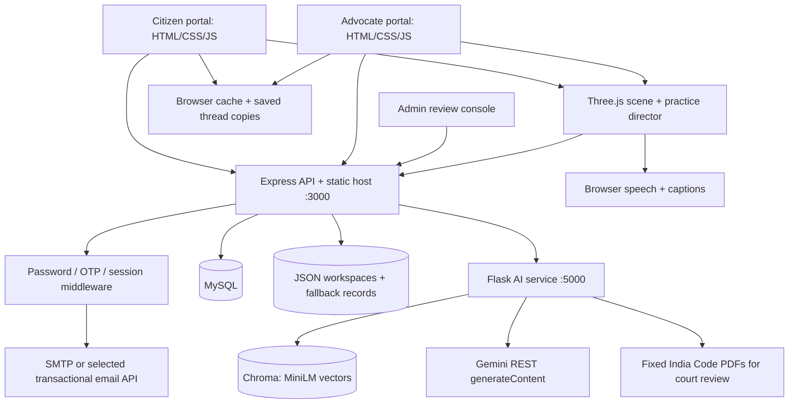
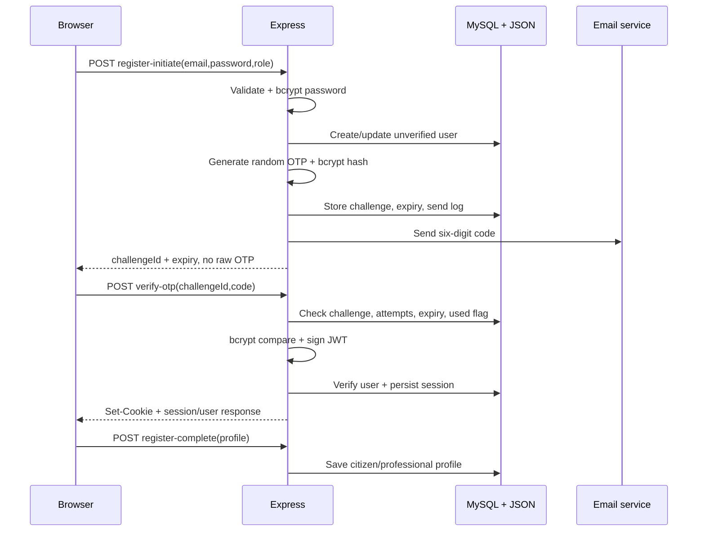
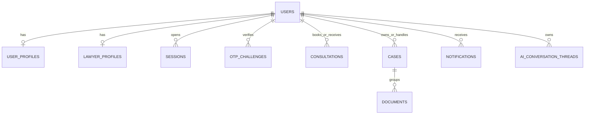
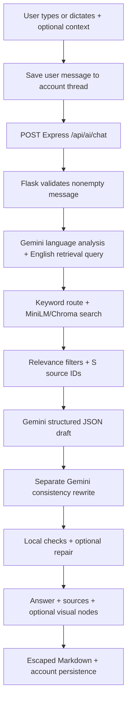

# Nyay Setu: complete technical guide for hackathon

**Audit date: 30 October 2026, India time. Language: easy Hinglish.**

Yeh guide current working code, running health endpoints, read-only database inspection aur automated tests par based hai. Existing uncommitted changes bhi review ka part hain. Application behaviour change nahi kiya gaya. Secrets, passwords, OTPs aur personal database records yahan copy nahi kiye gaye.

Saath mein padho: [judge/viva questions with answers](hackathon-viva-questions.md) aur [file/function/API code map](hackathon-code-map.md). Code map mein 143 source/config/test files aur 40,239 lines ka navigation inventory hai; root configuration aur historical docs separately listed hain. Binary PPTX/GLB/image contents aur third-party packages ka line-by-line review is scope mein nahi hai.

## 1. Sabse pehle project ka correct introduction

Tumhara project **legal assistance + advocate workspace + interactive courtroom practice** platform hai. Citizen apna problem explain kar sakta hai, contextual AI guidance le sakta hai, lawyers browse kar sakta hai aur consultation request kar sakta hai. Advocate clients, cases, documents, appointments aur payment ledger manage karta hai. Court practice mein judge/counsel/witness roles, manual answers, AI answers, follow-up questions, objections aur saved progress milte hain.

Presentation mein yeh bolo:

> “Nyay Setu combines a multilingual legal assistant, source retrieval, advocate case management and a browser-based interactive courtroom practice environment. We use Gemini for language generation, MiniLM embeddings with Chroma for retrieval, Express for application APIs, MySQL plus a legacy JSON workspace layer for persistence, and Three.js for 3D rendering. This is a working prototype; some secondary screens remain demonstrations.”

**Four essential distinctions:**

1. **LLM model:** Gemini generates text. **Embedding model:** MiniLM creates vectors. **3D model:** GLB avatar contains geometry/rig/animation. In teeno ka purpose different hai.
2. **AI chat real hai.** Har screen jahan “AI” likha hai woh Gemini call nahi karti. Intake classification aur advocate case templates ke kuch parts static/rule-based hain.
3. **Court simulation educational practice hai.** Actual court order, outcome prediction, e-filing integration ya guaranteed legal correctness nahi hai.
4. **Implemented, configured aur verified alag hain.** Code mein five collections configured hain; running service mein abhi only NDPS collection loaded hai.

### Current verified facts

| Item | Audit mein kya verify hua |
|---|---|
| Backend | Port 3000 health response online |
| Email | Selected channel SMTP; configuration exists; fresh email delivery test nahi kiya |
| Relational database | Read-only connection succeeded, MySQL 8.0.45, 17 tables visible |
| AI service | Healthy through backend proxy, port 5000 service |
| Loaded corpus | `sc_narcotics_ndps`: **24,776 vectors**, 384 dimensions |
| Other four Chroma folders | Folder/SQLite files present, lekin collection rows absent, zero embedding records |
| Embedding metadata | `all-MiniLM-L6-v2`, sentence-transformer implementation, CPU, cosine space |
| JavaScript regression | **80 passed, 0 failed** |
| Python regression | **83 passed, 0 failed** |

24,776 vectors ka matlab 24,776 unique judgments nahi hai. Ek judgment ke multiple text chunks ho sakte hain. Health response model name hardcoded hai; individual provider response mein kaunsa fallback actually used hua, health se prove nahi hota. Is audit mein fresh paid/provider generation nahi ki gayi.

## 2. Technical stack: kya use ho raha hai aur kyun

“Kyun” ke answers architecture ke practical trade-offs hain; repository original author's har choice ka written decision record provide nahi karti.

| Technology | Current responsibility | Is prototype mein useful kyun | Alternative aur trade-off |
|---|---|---|---|
| HTML | Landing, portal shells, admin console | Direct browser rendering, simple hosting | React/Vue templates bigger UI mein component discipline denge |
| CSS | Shared tokens, layouts, animations, portal themes | Full styling control, no build dependency | Tailwind/design system consistency improve kar sakta hai |
| Vanilla JavaScript | Page renderers, stores, event handlers, router | Fast prototype, direct Three.js integration | React/Vue + TypeScript complexity aur state contracts manage karenge |
| Hash router | `#/home`, `#/cases/id/...` | Server rewrite rules ke bina SPA navigation | History router cleaner URLs, server fallback configuration needed |
| Fetch + JSON REST | Browser/API/service communication | Standard HTTP, easy debugging | SSE for answer streaming; WebSocket for two-way live messaging |
| Node.js | Application API runtime | JavaScript stack, async I/O | Python-only backend simpler language count, but existing JS code rewrite hoga |
| Express 4 | Routes, middleware, static assets | Lightweight application plumbing | Fastify/NestJS structured contracts/scaling conventions offer karte hain |
| Python | Retrieval, prompts, review, PDF text extraction | Existing NLP/vector ecosystem | Node AI libraries possible; current Python logic migrate karna padega |
| Flask | AI microservice HTTP layer | Small service, few routes | FastAPI schema validation/async options dega; migration itself latency solve nahi karega |
| Gemini | Query analysis, multilingual answers, courtroom dialogue, reviews | Hosted inference; model host/GPU maintain nahi karna | Other hosted LLMs or local model; compare with real domain evaluation |
| MiniLM | Query/document semantic embeddings | Compact 384-dimensional vectors; local CPU operation | Multilingual/domain encoders evaluate kar sakte hain; re-indexing needed |
| ChromaDB | Legal excerpt vector retrieval | Local persistent index, metadata with passages | FAISS lower-level; pgvector shared relational infra; managed vector service operational trade-offs |
| MySQL + mysql2 | Identity/profile/session/consultation records, AI threads | Relationships and parameterized SQL; connection pool | PostgreSQL equally possible; no universal winner implied |
| JSON file store | Workspaces, security/review records, fallback/cache | Simple local demo persistence | Transactional DB better for concurrent production writes |
| localStorage | UI caches, account-specific chat copies | Reload persistence, instant UI | IndexedDB handles larger structured data better; both need privacy controls |
| sessionStorage | Pending OTP/booking/room state | Survives refresh within tab session | Durable records need server persistence |
| bcryptjs | Password/OTP hashing | Salted, expensive comparisons | Argon2id can be evaluated; raw SHA alone password hashing nahi hai |
| jsonwebtoken + cookies | Signed sessions | Cookie travels automatically, server can verify signature and session record | Opaque session ID + server store also valid |
| Nodemailer / mail REST APIs | OTP/reset email | Transactional delivery; SMTP is selected locally | Provider choice depends on reliability, limits, domain setup |
| Multer | Multipart credential upload | Handles file stream/form fields | Object-storage upload flow at scale |
| Three.js r128 | Browser 3D scene and animation | Existing JS app mein WebGL renderer | Babylon.js or Unity/Godot export; different tooling and asset pipeline |
| Web Speech APIs | Speech input/output controls | Browser integration, no custom speech model server | Dedicated STT/TTS for predictable voices, consent, cost and network considerations |
| Helmet/CORS/Morgan | Headers, cross-origin policy, request logs | Common application middleware | Configuration must still match deployment threat model |
| PM2/BAT scripts | Local process restart/startup | Demo processes can recover | Containers/services improve deployment consistency; Kubernetes is not currently implemented |

Official model documentation describes Gemini 3.1 Flash-Lite as optimized for latency and cost-sensitive workloads. Yeh model choice ka reasonable motivation hai, lekin tumhare app ka measured superiority benchmark nahi hai. [Google model documentation](https://ai.google.dev/gemini-api/docs/models/gemini-3.1-flash-lite)

## 3. End-to-end architecture



**Why two services?** Express owns application concerns: identity, uploads, profile/workspace APIs, static assets. Flask owns AI concerns: retrieval, language analysis, prompt construction, structured generation, reviews. Is boundary se future mein AI CPU/GPU resources aur app API scale independently kiye ja sakte hain. Current deployment local two processes hai; comprehensive distributed microservice infrastructure claim nahi karna.

**Trust boundary:** browser ke values trusted identity nahi hote. Strict endpoints cookie/JWT + session + user validate karte hain. Kuch newer business routes optional authentication use karti hain; unki limitations section 15 mein hain.

## 4. Startup aur website load ka flow

1. `backend/src/config/envConfig.js` project `.env`, phir optional backend `.env` load karta hai. Production mode secret/email/admin configuration validate karta hai.
2. `backend/src/app.js` Express app banata hai. Helmet, reflected-origin credentialed CORS, JSON body limit **3 MB**, cookie parser aur request logging mount hote hain.
3. `/api` par routes mount hote hain. `/frontend` static files serve karta hai. `/`, `/user`, `/lawyer`, `/admin` convenient entry points hain.
4. `server.js` JSON store load karta hai, seed function run karta hai aur configured host/port par listener start karta hai. Actual JSON data default location user home ki `.Nyay Setu_data/db.json` hai; repository `backend/data/db.json` ko automatically live authoritative file mat samajhna.
5. Startup ke baad AI supervisor health check karta hai. Service unavailable ho to Python launch attempt karta hai. Yeh full continuous health monitor nahi: startup/chat-failure triggered checks hain.
6. Flask startup `get_rag_engine()` singleton banata hai, existing Chroma collection load karta hai. Query par database/model reload karna avoid hota hai, though embeddings ki first-use initialization slow ho sakti hai.
7. Browser portal HTML aur ordered scripts load karta hai. Foundation → pages → assistant integration → live court integration → app bootstrap.
8. `DOMContentLoaded` par store initialize, routes register aur hash route render hota hai.
9. `Router.navigate()` auth UI guard check karta hai, previous page `onLeave`, target render, page title/transition aur `onEnter` run karta hai.

**Important implementation detail:** modern `assistant_chat.js` existing `UserChatBot`/`AdvocateChatBot` methods replace karta hai. `live_court.js` simulator methods wrap karta hai. Sirf old `chat_bot.js` dekhkar final behaviour explain karna incomplete hoga.

**Current production gaps:** Flask built-in server use hota hai; dedicated production WSGI deployment absent. Static responses no-cache hain, so updated demo assets reliably reload, but production caching optimization pending. Three.js remote CDN se load hota hai, so fully offline first load guaranteed nahi.

## 5. Frontend modules aur state management

### Citizen portal

`frontend/user/js/app.js` routes register karta hai: onboarding, login/register/OTP, home, tell-us/cases, chat, lawyer discovery, consultation booking, court prep/simulation, profile/settings/security/support.

`UserStore` **framework state library nahi**; simple object + getter/setter + localStorage hai. Key account email/id se banti hai: `lc_user_store_<sanitized identity>`. Cases, documents, consultation cache, language aur onboarding flags yahan reside karte hain. Har citizen-side local record ka equivalent server persistence implemented nahi hai.

### Advocate portal

`Store` state, subscribers, computed dashboard selectors aur per-collection API sync provide karta hai. `setState()` instantly UI/cache update karta hai, phir debounced PUT sends. Whitelisted collections: clients, cases, appointments, transactions, reviews, notifications, conversations, experience, caseExperience, certificates, pricing, availability, settings.

`GET /api/state` current authenticated ID ka JSON workspace aur profile returns. `PUT /api/state/:collection` selected collection replace karta hai. Yeh SQL workspace transaction nahi hai. Browser key `lc_store_cache` global hai; account-specific namespace nahi. Logout cleanup aur timers ki limitations section 7/15 mein padho.

### Shared assistant persistence

`AssistantThreads` stronger account-scoped layer hai. Local key `nyay_assistant_v1_<owner>`, each thread has messages, language, revision, dirty flag, courtSessions. It:

- New Chat par old chat preserve karta hai.
- 400 ms debounce se server sync queue karta hai.
- Sync snapshot ka owner capture karta hai; account badle to stale response ignore karta hai.
- Server revision outdated ho to **409 conflict**, local copy retain; silently overwrite nahi.
- Chat delete par tombstone + empty messages saves, court sessions retain.
- Separate court-session delete supported.
- JSON export offers local backup; encryption is not implied.

Prototype convenience ke liye old methods ko runtime wrap/replace kiya gaya hai. Long-term explicit imports/interfaces aur TypeScript preferable honge, because script order aur hidden overrides debugging difficult karte hain.

## 6. Registration, login aur session: har step

### 6.1 Registration



1. Frontend email/password/role sends. Backend validates email and password: minimum 8 chars, at least one letter and digit. Complexity policy ko stronger password/breach screening se extend kar sakte hain.
2. Password `bcrypt.hash()` se hashed. Hashing one-way comparison mechanism hai, reversible encryption nahi. Salt bcrypt hash mein encoded hota hai.
3. Verified existing email gets conflict. Unverified leftover account can be refreshed; role allowlisting on this update needs attention.
4. User begins `awaiting_otp`. Lawyer/citizen profile completion logic different hai.
5. OTP `crypto.randomInt(100000,999999)` se generated; max bound exclusive hai. Code stored as bcrypt hash, raw OTP for delivery only.
6. Challenge has purpose, ID, expiry, attempt count, used/locked state, device context. Challenge data has both MySQL and JSON handling.
7. Current configurable OTP defaults: **5-minute validity, 5 wrong attempts, 30-second resend cooldown; 20 sends/15 minutes development, 5 production**. README/comments saying 60 seconds and 3 sends are stale. Actual env overrides ho sakte hain; local file mein in values ke overrides absent the.
8. `mailService.activeChannel()` priority se one provider select karta hai: Resend → Brevo → SendGrid → SMTP. Yeh priority selection hai; selected provider fail ho to automatic next-provider cascade implemented nahi.
9. Email absent ho to development console path exists; production config validation missing email reject karti hai. Email successfully accepted by SMTP still inbox delivery guarantee nahi.
10. Verify route code shape, challenge lookup, lock/expiry/single use aur bcrypt match check karta hai. Successful verification user verified marks and session creates.
11. JWT payload has `sub` user ID, `role`, `sid` session ID plus JWT timing claims. Session record JSON/MySQL mein stores. Separate record allows logout/session revoke beyond JWT expiry.
12. Cookie `lc_session`: HttpOnly, path `/`, SameSite default lax, Secure production mein default true, duration default 24h.
13. Profile-complete route strict authentication requires. Advocate personal/professional fields validate; bar identity checks/review stages start. Email verify hona professional eligibility verify hona nahi.

**Cookie kyun?** Browser automatically sends it to matching requests; HttpOnly prevents normal JavaScript from reading cookie value. Secure limits transport to HTTPS; SameSite reduces certain cross-site sends. Yeh complete XSS/CSRF protection nahi. [MDN cookie attributes](https://developer.mozilla.org/en-US/docs/Web/HTTP/Reference/Headers/Set-Cookie)

**Current deviation:** OTP verification JSON response also includes `token`. Thus “JWT never touches JavaScript” current code ke liye incorrect claim hai. Normal frontend cookie flow uses it without intentionally storing that token field, but response body JS-readable hai. `publicUser` filtering ka separate issue bhi section 15 mein hai.

### 6.2 Login

1. Identifier/email + password arrives.
2. MySQL identity lookup first, JSON fallback next.
3. Recent failed attempts check: 5 failures within 15 minutes blocks further login until window clears. Tracking JSON activity log based hai; distributed rate limiting nahi.
4. bcrypt password comparison. Unknown-account errors explicit hain, so login endpoint enumeration-safe claim nahi karna.
5. Suspended account blocked.
6. Successful password → **always OTP challenge** in current backend path. Trusted device records device context; they do not bypass this mandatory OTP.
7. OTP verify → session/cookie → portal route.
8. New device may require confirmation; device browser/OS is user-agent parsing, location string approximate/hardcoded India, precise IP geolocation nahi.

Current controller mein direct-login branch exists, but ordinary authService.login always OTP issues. UI network-error fallback separately can show offline signed-in state; isko real authenticated server session mat call karna.

### 6.3 Every protected request

`authenticate()` Bearer token first, otherwise cookie reads; JWT signature/expiry validates; `sid` ka session exists/unrevoked checks; user loads; suspended account blocks; request gets `req.user` and `req.session`. Admin actions additionally `requireRole('admin')` use karte hain. Certain sensitive operations incident lock par 423 return karti hain.

`Router.requiresAuth` sirf UI guard hai. Backend middleware actual access-control boundary hai. localStorage ko edit karke UI personalized dikh sakti hai; secure backend ko phir bhi valid credential chahiye.

### 6.4 Logout

Frontend `POST /api/auth/logout` sends cookie. Backend current session revoke, activity log, cookie clear, `{ok:true}` returns. Frontend UI snapshot and pending OTP remove, login route navigates. Server revoke ka purpose: old signed token use karke strict endpoints access na kar sakein.

Limitations: frontend logout network failure ko best-effort treats, so offline sign-out server revoke guarantee nahi. `window.Store` cleanup guard problem, outstanding timers aur optionalAuth's missing session validation mean system-wide logout guarantees need further work.

### 6.5 Forgot/reset/change password

Forgot endpoint generic response returns whether account exists; generated reset token random bytes, stored hash, **30-minute expiry**, single use. Link currently lawyer portal reset route point karta hai, even for citizen users. Reset hashes new password and revokes sessions. Change-password endpoint current password verifies, new hash stores and other sessions revokes.

Code-level bug to address: reset path calls `logActivity` without a request, while `getDeviceProfile(req)` reads `req.get(...)`; this can throw after some updates. Yeh flow currently clean end-to-end verified nahi. SMTP delivery, reset-route parity and atomic updates need integration checks.

## 7. Account switching: exactly kya supported hai

Separate multi-account switcher API/function nahi mila. Typical supported journey: account A logout → account B login/OTP → B workspace load. Citizen and advocate portals same origin/cookie namespace share karte hain; separate app URLs do not automatically mean independent simultaneous sessions.

| Layer | Switching behaviour | Important limit |
|---|---|---|
| Cookie | Same-origin current `lc_session` changes with login | Another tab may retain old visual state until refreshed |
| UI snapshot | `localStorage.lc_session` stores profile/session metadata | Snapshot is not the credential; one shared key |
| Citizen store | Identity-derived local key | Needs correct `UserStore.init()` on each account journey |
| Advocate cache | Global `lc_store_cache` | Not account-namespaced, so cleanup/hydration must be reliable |
| Assistant threads | Owner-specific key + owner checks | Stronger isolation here is tested; does not prove every portal feature is isolated |
| MySQL assistant rows | `(owner_id,id)` primary key, owner from strict authentication | Stored rows scoped by authenticated user |
| Live court | Captured owner/session context | Changed owner makes previous session inaccessible to live controller |

Important bug: scripts declare `const Store`, `const UserStore`, `const AuthManager` globally, but several calls test `window.Store` / `window.UserStore`. Classic top-level `const` does not automatically create a matching window property, and explicit assignments were not found. Consequently some intended refresh/cleanup branches may never execute. `Store.resetLocal()` itself also doesn't clear pending sync timers. Account switch should be evaluated across the whole product, not only assistant tests.

Practical improvement: account-ID cache namespace, explicit module exports/imports, cancel all pending writes when owner changes, server session revalidation on app start, and cross-tab `storage`/BroadcastChannel coordination. A UI role switch must never grant a different server role by itself.

## 8. Database design aur complete persistence flow

### 8.1 Four storage systems, four purposes

| Storage | Kya store hota hai | Why separate |
|---|---|---|
| MySQL | Users/profiles, OTP/session records, consultations, notifications, cases/doc metadata; AI thread JSON payloads | Account/business relationships and durable shared records |
| JSON file | Workspaces, trusted devices/activity/review records and fallback/cache records | Existing local prototype layer; not all modules migrated |
| Chroma | Legal document embeddings, text chunks, metadata | Semantic retrieval for AI; not a login database |
| Browser storage | UI snapshot, local chat/session copies, language/drafts/bookings | Fast rendering and recoverability, not trusted authorization |

### 8.2 MySQL entities and relationships

`users` is identity. `user_profiles`/`lawyer_profiles` contain role-specific details. Cases link citizen and possibly advocate; consultations link user/lawyer and optionally case. Notifications target account. Sessions reference identity. Document records reference owner/case. AI threads key by owner/thread.



Diagram application relationships explain karta hai; every shown relation ko deployed schema-enforced foreign key assume mat karna. Repository mein PostgreSQL schema/migration mirror aur multiple MySQL SQL versions exist hain; runtime code `mysql2` use karta hai. “Production PostgreSQL active” README se claim nahi karna. Actual read-only MySQL connection verified hai.

`DbService` pool: connection limit 10, waiting enabled, keep-alive. Pool object creation par “Connected” log print hota hai, jo successful SQL query ka proof nahi. This audit separately actual connection query ki.

Queries use `?` placeholders for data values, reducing SQL injection risks. Placeholder use alone ownership, validation or workflow correctness ensure nahi karta.

### 8.3 MySQL + JSON fallback: benefit and cost

Most service methods try SQL, catch errors and use/mirror in-memory JSON. Benefit: local demo SQL outage mein some UI actions continue. Cost: it is **best-effort dual writing**, transactional replication nahi. One database write pass, second fail ho to inconsistent states possible. Some updates are fire-and-forget; some responses may be success-looking despite persistence failure.

JSON `save()` rapid writes ko **120 ms debounce** karta hai, temporary file writes then rename. Rename reduces partial-file corruption. It does not provide relational transactions, cross-process locking, rollback, durable commit acknowledgement or robust backup. JSON load failure currently starts an empty store; this needs stronger recovery handling in production.

### 8.4 AI chat/court sessions in MySQL

`assistantRepository.js` lazily creates `ai_conversation_threads`. Fields: owner_id, id, revision, payload LONGTEXT, updated_at. Composite primary key `(owner_id,id)`. Payload includes messages and nested courtSessions, giving flexible schema without many child tables.

Save sends `expectedRevision`. UPDATE includes owner, ID **and revision**. If row affected → revision increment. If outdated → 409. Yeh optimistic concurrency control hai: two tabs ko silently overwrite karne se rokta hai. Conflicts automatically merge nahi hote; UI preserves local copy/export and asks refresh.

This repository **requires MySQL**, unlike broader DbService fallback. Database unavailable ho to API 503; browser local copy retains changes. Whole-project “everything falls back to JSON” claim therefore incorrect hai.

### 8.5 Migration status

Live DB mein 17 tables visible, including `account_workspaces`, `account_migrations`, `account_trusted_devices` etc. Table existence ka matlab current code uses them nahi. Current stateController still JSON workspace calls karta hai. Canonical migrations and repository contracts consolidate karna needed hai. `database/setup_mysql.js` older `init_mysql.sql` reads, while a separate fuller MySQL schema also exists.

## 9. AI model aur RAG: sabse important detailed section

### 9.1 Kaunsa model kis kaam ke liye?

| Task | Current code/configuration |
|---|---|
| Language/problem analysis | Direct REST call to `gemini-3.1-flash-lite` |
| Ordinary chat generation/review | Ordered candidates: `gemini-3.1-flash-lite`, `gemini-3.1-flash`, `gemini-flash-lite-latest`, `gemini-flash-latest` |
| Court generation | Preferred successful model, then configured `gemini-3.1-flash-lite` / `gemini-3.5-flash-lite`; maximum two eligible attempts per transport call |
| Court consistency/legal review | Same configured court-family selection, separate preferred-model/timeout cooldown state |
| Embeddings | Persisted Chroma config: `all-MiniLM-L6-v2`, CPU, **384 dimensions** |
| Training | `training/train_model.py`, preprocessing/evaluate files empty; custom LLM training/fine-tuning absent |
| 3D characters | Existing `.glb` files, not ML models |

Fallback list is code configuration, not proof all names currently resolve for this account. The project’s 29 October validation document records prior synthetic provider checks; this audit freshly checked health and offline regressions only. `gemini-3.1-flash` in ordinary chat list should be verified against provider availability before depending on it.

Despite `google-generativeai` appearing in requirements, active generation uses **Python urllib HTTP requests** to Google `v1beta/models/{model}:generateContent`. SDK presence does not mean SDK is the execution path. No LangGraph/CrewAI/autonomous agent framework is used here; role-specific prompt calls and a JS state machine orchestrate the workflow.

### 9.2 RAG kya hai, simple example

RAG = **Retrieval Augmented Generation**. Suppose citizen describes a narcotics seizure dispute in Hindi. System pehle English retrieval query banata hai, matching stored judgment passages searches, phir those passages + original facts Gemini ko context mein deta hai. Gemini ko entire 24,776-vector corpus every request mein nahi bheja jata. Sirf selected excerpts send hote hain.

Pretrained model has general language capabilities. Vector database holds your external searchable material. RAG adds relevant material at inference time; it does not change model weights. Isliye “humne Gemini ko 24,776 cases par train kiya” incorrect hai.

### 9.3 Embedding kya hota hai?

Embedding text ka fixed-length numeric representation hai. Related meanings nearby vectors produce karne ki training encoder mein already hui hoti hai. `all-MiniLM-L6-v2` here 384 values per passage/query represents. Dimension is representation size, not accuracy percentage or count of legal features.

Example conceptually: “illegal drug seizure” aur “narcotics recovery” exact words alag hain but semantic similarity possible hai. Embedding itself law explain nahi karta, judgment issue nahi karta, answer write nahi karta. Uska role candidate evidence retrieval hai.

Persisted collection schema specifically sentence-transformer implementation specifies. `LegalRAGEngine.__init__` also constructs `DefaultEmbeddingFunction`, but it does not explicitly pass that object into `get_collection()`. Actual loaded collection embedding settings ko precedence dena chahiye. Same encoder/dimensions during ingestion and query important hain; model change karo to re-embed/re-index and evaluate.

### 9.4 Data preparation versus active runtime

Repository mein two related ingestion scripts hain:

- `ingest_legal_data.py`: flexible JSON legal records ko title/court/category/sections/content text mein formats, MiniLM embeddings ke saath upsert karta hai. Destination `ai-service/data/processed/chroma_db`, collection `legalconnect_laws`.
- `ingest_supreme_court.py`: Supreme Court hearings/full_text reads, recursive character splitter **1,200 characters**, **150-character overlap**, metadata/header adds, batches of 150 upserts. Destination `ai-service/data/processed/chroma_db_supreme_court`, collection `supreme_court_judgments`.
- Active `rag_engine.py`: **different path**, `data/chroma_db/chroma_SC_*`, with five category-specific collection names. `data/extract_all_dbs.py` prebuilt category ZIP archives extracts there.

Thus listed ingestion scripts are not a complete wired reproduction of the currently loaded category database. “Run ingest and all five active collections regenerate” current code does not guarantee. Ingestion script imports `langchain.text_splitter`, but requirements does not declare LangChain; reproducible dependency setup needs correction.

Chunk overlap why? Agar important condition paragraph boundary par cut ho, neighboring chunk overlapping text retain kare. Trade-off: duplicate text, storage and retrieval repetition. The splitter is character-based with semantic-friendly separators; learned semantic boundary model claim mat karna. Current loaded prebuilt corpus ka every chunk exactly this size se built hua, code alone prove nahi karta.

### 9.5 Retrieval algorithm: exact steps and parameters

1. `is_legal_query()` keyword-based broad scope filter: court, lawyer, bail, property, contract etc. This is heuristic classification, not separate trained legal-intent model.
2. `route_query()` category keyword occurrences score karta hai: each matching keyword +2. Maximum top two nonzero categories; none matched ho to all five candidates.
3. Missing/unloaded collections skip. Runtime only narcotics loaded hai, so corpus coverage limited.
4. `collection.query(query_texts=[query], n_results=min(top_k,5))` query embeds and searches. Chroma single-node HNSW approximate nearest-neighbor index use karta hai. Persisted config here confirms cosine space, ef_search 100, max_neighbors 16, ef_construction 100. [Chroma index documentation](https://docs.trychroma.com/docs/collections/configure)
5. Returned distances filter: **distance < 0.58**. Cosine distance lower = more similar; conceptually distance = 1 − cosine similarity. Threshold is heuristic relevance control, no statistical legal-accuracy calibration.
6. Results sort by ascending distance and truncate overall top_k.
7. Chat grounding asks top_k=6, but each collection max5. With one loaded collection, at most5 results from that call—not always6.
8. Additional guard removes narcotics results when English query lacks explicit NDPS/drug-related cues. Generic “recovery/witness” should not attach irrelevant drug precedents to tenancy matters.
9. Sources get IDs S1, S2... plus metadata, public excerpt up to1,600 chars; prompt excerpt up to6,500 chars per result.

Cosine similarity alone does not establish same jurisdiction/date/facts or whether a passage is counsel argument versus court holding. Relevant law needs further checks. Wrong routing, weak translation, duplicate chunks or missing corpus can still cause retrieval misses. Threshold should be tuned with labeled queries and recall/precision evaluation.

### 9.6 Ordinary chat: complete request flow



**Step A — Browser capture.** `AssistantChat.send()` active thread and owner capture karta hai. User message immediately saved, so later service failure original question remove nahi karta. Pending set prevents same-thread duplicate concurrent sends.

**Step B — Attachments.** Text/CSV FileReader context include ho sakta hai. PDF/image file paths in this chat do not have a working universal PDF/OCR extraction pipeline. Integration explicitly says only metadata available for non-text files, so model must ask for relevant text. Credential document upload is a different real upload feature; upload success means model understood contents nahi.

**Step C — Browser request.** Sends message, user/lawyer role, language, caseContext, prior chatHistory, retry flag. Browser timeout ordinary chat **240 seconds**. Backend forwards JSON to AI service. This is one full HTTP JSON response; token streaming/SSE implemented nahi.

**Step D — Language and issue analysis.** Detector uses first part of earlier user history + latest message. Returns detected language, English retrieval query, issue analysis. Original user message remains factual authority. Detector-generated sections/analysis are not verified law. This detector currently still makes model call even if explicit output language was selected.

**Step E — Evidence.** Grounding performs search/filter/source IDs described above. Noncovered issues remain answerable using conditional practical guidance, with short source-limit note. No source means fabricated exact sections, statutory years, citations or guaranteed rights should not be presented.

**Step F — Prompt construction.** System instruction says user messages, attachments and excerpts are untrusted data, not instructions. It separates alleged/established/unknown facts; citizen gets accessible explanation, lawyer gets professional detail. The original facts and history have higher factual authority than AI translation/analysis.

**Step G — Context window policy.** `history_context()` keeps all up to20 messages; otherwise first4 + last16, each text capped18,000 chars, serialized cap90,000 chars. This preserves opening facts/recent conversation but can lose intermediate facts. It is not unlimited memory or a full summarization engine. Attachment context from prior turns is not independently preserved in that flattened history unless text included it.

**Step H — Structured generation.** Draft returns JSON: message, optional visual nodes, source_ids, unknowns. Temperature0.2. Standard transport topP0.85, topK40, maxOutputTokens8192. Lower temperature reduces sampling diversity, not hallucination probability to zero.

**Step I — Length policy.** Query >180 characters or caseContext present triggers substantive instructions roughly450–650 words, at least350 meaningful words. Narrow follow-up usually90–180. These are prompt/repair heuristics; character count is an imperfect proxy for complexity.

**Step J — Review.** A separate call reviews latest question, actual earlier facts, attachment and retrieved excerpts, then rewrites. Checks include answers_question, facts_match, evidence_supported, language_matches, useful_without_local_sources, balanced_detail. Temperature0.1. Same provider/model family reviewing itself can share errors; “independent human/legal verification” nahi.

**Step K — Repair/local gating.** Failed checks, unsupported numbered law when no sources, or too-short substantive answer can trigger correction at temperature0. Continued failures may use bounded Hindi practical fallback or return recoverable error. Review checks are model-produced values; missing flags are not universally enforced as strict required booleans in chat, unlike stronger court schema checks.

**Step L — Citation normalization.** Returned `[S99]` that does not belong to retrieved source IDs is removed; grouped citations normalize too. This validates source-ID membership, not every proposition's legal truth. Only used source records return to UI.

**Step M — Visuals.** Model can return title + max8 nodes, each capped title/detail length. UI draws an ordered explanation/flow. This is text-derived visualization, not a statistical simulation or image-generation model. Numeric data should not be invented.

**Step N — Render and save.** Markdown text escaped before HTML formatting, sources expandable, response appended to captured thread, local/server sync. Owner changed during call → response ignored for current user. Negative feedback re-asks saved user request with retry flag; it does not fine-tune model weights.

**Call budget:** Usually language detection + draft + review = **3 logical LLM calls**, optional repair =4. Transport retries/fallbacks can create additional provider attempts. Claiming “one API call per chat” would be wrong. More calls increase latency/cost, so next optimization is measured routing/caching and selective review, not blindly removing safeguards.

### 9.7 “Zero hallucination” kyun claim nahi karna

Code header says “Zero-Hallucination”, but no LLM/source-filter workflow can establish that guarantee here. Evidence coverage limited hai; retrieval and model can err; current-law status not universally verified; quoted case context may be incomplete. Safe technical statement:

> “We reduce unsupported answers with retrieval relevance filtering, explicit unknowns, source-ID checks, a second consistency pass and constrained fallbacks. We have not established zero hallucinations or a measured legal-accuracy percentage.”

## 10. Interactive 3D court: full technical breakdown

### 10.1 Five cooperating modules

| File/module | Main job |
|---|---|
| `indian_courtroom.js` | Court layouts, furniture, lights, staff/gallery figures, geometry/resources |
| `courtroom_director.js` | Deterministic procedure/movement timeline, localized fixed cues |
| `court_simulator.js` | Three.js scene, avatar rigs/mixers, frame loop, cameras, speech, stage controls |
| `live_court.js` | Real incremental AI requests, witness ownership, transcript/review/persistence integration |
| `saved_court_sessions.js` | Saved library, resume/delete navigation |

Court workflow has **generative dialogue** and **deterministic execution**. Gemini text generates; JS decides actor movement, answer gates, pause/resume and camera transitions. Gemini every frame geometry render nahi karta.

### 10.2 Chat se separate hearing kaise banti hai

1. User AI response par Virtual Court launch karta hai.
2. `LiveCourt.launch()` selected thread/message tak **user-authored messages + caseContext** joins into brief. Previous AI advice ko established facts treat nahi karta.
3. Existing session for message hai to resume; otherwise new courtSession: id, source message, title, summary, language, transcript, rooms, role.
4. `/api/ai/court`, action `opening`, sends brief, selected court, language and completed history.
5. AI2–4 short bench/counsel turns returns; no witness answer, no assumed final judgment. Review may neutralize unsupported opening.
6. Script and session save, simulator route opens.
7. Courtroom director builds movement/procedural stages around those lines. Stage execution and witness practice starts.

Standalone room demo and chat-launched live hearing differ. Old script-only cache without supported live case record uses neutral demonstration; it cannot bypass current review by replaying unchecked old AI script.

### 10.3 Court layouts and cameras

- Supreme: three-member representative practice bench, larger gallery.
- High: two-member representative bench, distinct materials/windows.
- District: single judge, separate dock/staff zones.
- Each has both witness stations; views include wide, judge, both counsel, both witnesses, gallery, staff.

These are representative educational layouts, not exact surveyed real-court replicas. Supreme/High Court witness exercises illustrate practice; routine witness examination in every appeal claim incorrect hai. Choosing room does not independently establish real case jurisdiction.

### 10.4 Scene initialization and frame loop

Scene includes PerspectiveCamera, WebGLRenderer, lights/shadows, room meshes, avatar groups, props. GLTFLoader parses cached GLB buffers. Height normalized roughly1.78 model units; clothing/material adjustments and court bands attach. AnimationMixer plays existing skeletal talking clips; procedural head/gaze/walk/gesture movement overlays them.

`requestAnimationFrame` → calculate delta/time → update mixers/stage motion/camera → renderer.render(scene,camera). Browser GPU rendering handles graphics. No server-rendered video stream is required for the simulation.

Render quality selector targets1920/3840 width subject to device/scale constraints. Ultra scale cap3, total pixel cap8,294,400. This is render resolution target, not photorealism guarantee. Instanced supporting people reduce draw calls; model buffers cached so switching rooms avoids repeated downloads. Reduced-motion preference suppresses procedural movement.

Existing GLBs have body animation but no verified facial blend-shape phoneme pipeline. Correct claim: **speech-coordinated body/head motion**, not accurate lip sync or real facial emotion model.

### 10.5 Deterministic state machine

Typical timeline:

```text
Counsel requests permission
→ judge practice response
→ witness entry + counsel approach
→ direct question
→ await-answer gate
→ answer spoken/captioned
→ optional direct follow-up
→ opportunity for opposing cross-examination
→ cross question / no further questions
→ objection → ruling → question edit, if selected
→ answer completion
→ witness release + return
→ next recorded moment / continue hearing
```

Stages include practice, move, dialogue/live, question, await-answer, answer, choice, edit-question. Each stage has actor, positions/paths, duration, sourceIndex, witness/side/questioningStage identifiers and interaction keys. Deterministic snapshots allow pause, skip where valid, room switching and restoration.

Next cannot skip an unanswered witness question or interrupt an ongoing answer. `No further questions` ends that questioning branch; it doesn't fabricate testimony. Fullscreen is browser control, independent of legal engine.

### 10.6 Who controls which witness?

`DEFENSE` internally denotes user's counsel, even if user is claimant in a civil dispute. `PROSECUTION` denotes opposing counsel, not always actual public prosecutor. This generic internal naming is a limitation for legal realism; UI labels should be posture-specific in future.

- Defense-side witness defaults manual; user may explicitly choose AI assistance.
- Opposing witness uses AI from case facts.
- Direct stage questioner is witness's presenting side.
- Cross stage questioner is the other side.
- `witnessId` distinguishes multiple witnesses even on same side.
- Judge clarification retains judge actor; questioner/stage ownership stays consistent.

Backend checks side, `WITNESS_<side>`, direct/cross and questioningSide consistency. It rejects AI witness answer for manual defense mode. These are workflow validation controls; since AI route itself is public and payload is client-provided, it is not a substitute for authenticated server-owned hearing authorization.

### 10.7 Eight court API actions

| Action | Purpose |
|---|---|
| `opening` | Brief independent opening, no answer gate |
| `continue` | Next1–3 relevant hearing turns based on recorded hearing |
| `react` | Response/direct follow-up after actual accepted answer |
| `cross_question` | One context-aware cross question or decline |
| `rephrase` | Replacement question after ruling or withdraw |
| `witness_answer` | Exactly one active witness answer |
| `review_question` | Review submitted manual counsel question |
| `review_turn` | Review one pending judge/counsel speech before playback |

Request includes summary, language, courtType, action, input, role, history and active examination. Response uses strict turn actors, turns list, needs_answer boolean, witness_side, exact question. JSON schema + local normalization rejects wrong speakers, empty/incomplete answers and accidental testimony in non-witness actions.

Court transcript keeps complete accepted testimony/ruling record rather than chat's recent20-message policy. It is still bounded by HTTP body/provider token limits; “infinite hearing memory” claim incorrect hai. Future long sessions need summarization/retrieval with preserved evidence references.

### 10.8 Witness testimony versus generated counsel: review difference

Human witness answer is preserved verbatim, including contradictions or claimed law. Review must not rewrite evidence to make it “correct”. Later counsel can question inconsistencies. AI witness answer is generated under constraints and normalized to active witness, but bypasses separate counsel/bench review layer. It is simulation, not verified fact.

Counsel/judge speech gets separate bounded review against brief, completed transcript, roles/stage/rulings, language/repetition and legal support. Fixed dictionary practice cues are locally exact-text/speaker/language checked. Edited cues or substantive questions need server review.

Court review may fetch **fixed allowlisted India Code PDFs** for NDPS, BNS, BNSS, BSA if relevant. It restricts HTTPS host/redirects, PDF signature and download size, extracts text using pypdf, and selects passages. Every asserted legal sentence requires audit entry/support quote; reported details are separated from legal rules. A retrieval date does not prove latest consolidation, amendments, commencement or applicability. Review marks `current_consolidation_confirmed=False`, so universal current-law verification is not claimed.

Review unavailable/unsupported → conservative neutral direction/question or recoverable error, depending on action. It does not automatically approve fluent unsupported law. Reviewed markers/digests are internal workflow state, not cryptographic server attestations or legal certification.

### 10.9 Latency, retries and stale-response protection

- Court generation deadline34s; normally maximum two eligible provider attempts, each at most16s.
- Separate review deadline up to20s and overall action bound58s after start. Individual review transport attempt at most10s/remaining budget.
- Structured court calls cap output2048 tokens and request minimal thinking.
- Timeout cooldowns separate for generation/review; real provider rate-limit cooldown shared. 429 honors bounded Retry-After.
- Express court proxy timeout70s; browser75s.
- Frontend may automatically retry once for a retryable delay <=30s. That is a new request after delay, so whole user operation can exceed a single75s attempt.
- 503 exposes retry information; 400 used for malformed witness context/request.
- AbortController, requestId, sceneGeneration and record epoch invalidate late responses after route/room/account/stage changes.
- Draft edited during request → late result does not overwrite the edit. Submitted answer protected from duplicate append.

These mechanisms prevent common asynchronous race conditions. Provider outage/quota exhaustion still can stop generation; saved state and retry controls improve recovery, not uptime guarantee.

### 10.10 Saving/resuming and cleanup

CourtSession stores plain summary/script/transcript and per-room snapshots: stage/timeline, interaction drafts/answers, positions/camera/pause progress. Three.js object graphs never serialized. AssistantThreads local + MySQL thread payload persist the snapshots. Chat deletion retains preparation, separate delete removes it.

Review approvals bind text, session, room, language, examination, record epoch and five-minute window. New testimony/judge changes invalidate earlier approvals. On exit/pause/switch, pending audio/fetch callbacks cancel; renderer, geometry, materials/textures/skeleton textures and observers dispose. This avoids overlapping speech, stale movement and GPU memory leaks. Character-load timeout uses simple figures after18s; WebGL failure presents retry.

## 11. Voice input, TTS aur privacy

**Chat microphone:** `SpeechRecognition` / `webkitSpeechRecognition` browser feature uses chosen language and transcribes into input. No custom Whisper model is integrated. Browser support differs; some implementations send audio to their provider and require network. Do not promise fully offline/private local STT. [MDN SpeechRecognition](https://developer.mozilla.org/en-US/docs/Web/API/SpeechRecognition)

**Tell-us microphone:** separate old intake screen only changes UI and uses canned transcript. It is not the real chat speech-recognition pipeline.

**Current assistant read-aloud:** newer `AssistantChat` replaces old toggleSpeak with matching browser voice selection. Missing matching voice → notice, text remains visible. No arbitrary case text is sent by this current helper to the custom TTS endpoint. Browser/OS speech engine privacy still depends on selected voice implementation; it is not a blanket device-only processing guarantee.

**Court speech:** role-specific voice selection, pitch/rate, captions, speaker indicators and cancellation. Private case speech uses browser/OS voices. Missing voice → captions/manual answer-finished control. Only exact built-in procedural cues allowed by current client code go to custom fallback.

**Fallback endpoint:** Flask `/api/ai/tts` uses Google Translate `translate_tts`, returns audio/mpeg, truncates input to300 characters. It is not Gemini audio generation or a trained custom Indian TTS model. Server endpoint itself accepts arbitrary supplied text; allowlist is in current courtroom client, not a server authorization boundary. Legacy `chat_tts.js` still contains broader external fallback code, though modern assistant read-aloud overrides that path.

Express currently has no `/api/ai/tts` proxy route. Local simulator calls5000 directly; production same-origin fallback needs explicit routing. Source code comments “high-fidelity neural” or “22 languages” should not become universal audited capability claims. Core AI/practice language dictionary here has15 entries: English, Hindi, Telugu, Tamil, Marathi, Gujarati, Bengali, Kannada, Malayalam, Punjabi, Urdu, Odia, Assamese, Nepali, Sanskrit. Voice availability varies.

## 12. Website ke remaining features: actual status

| Feature | Current implementation | Judge ko correct explanation |
|---|---|---|
| Landing page | Static HTML/CSS/JS entry and portal navigation | Product overview, not AI inference |
| Citizen onboarding/language | Local language/onboarding flags and routes | Preference saving; entire UI fully translated claim nahi |
| Real AI chat | Shared assistant → Express → Flask → RAG/LLM/review | Working source-aware conversational feature |
| Chat follow-up/feedback | Saved context; retry improves prior answer | Not online model training |
| Chat source panel | Used S IDs and excerpts | Retrieved material, not legal certificate |
| Chat attachments | Text/CSV reads; nontext metadata | Full PDF/image analysis not implemented |
| Tell-us “AI classification” | Waits2s; result contains static property analysis | Prototype screen, not Gemini classifier |
| Tell-us create case | Toast/navigation; does not actually insert a new case in that handler | Incomplete creation flow |
| Tell-us lawyer hints | Keyword categories filter specialization, top3 | Rule-based suggestions |
| Lawyer listing | SQL-backed lookup with hardcoded fallback profiles | Distinguish live listing from demo fallback; named getVerifiedLawyers SQL filters active lawyers but does not require verified=true |
| Recommended lawyer “98%” | Static first-card compatibility badge | No calibrated trained matching model supports98% |
| Advocate AI case analysis | Templates chosen by category | Preliminary rule/template aid |
| Advocate dashboard insights | Dates, stale requests and pending records rules | Operational heuristics, not predictive AI |
| Consultation booking | POST creates consultation, mirrors workspace, writes notifications | Business request flow implemented |
| Payment screen | Calls booking; method selector/amount UI | No payment gateway charge or verified webhook |
| Advocate accept request | Server status update + case creation; client workspace appointment/ledger updates | Multi-step prototype, not one atomic transaction |
| Advocate case CRUD/notes | Store collections → JSON API, some SQL case writes in consultation path | Mixed persistence implementation |
| Case vault/exhibits | Advocate upload endpoint stores actual files and metadata | Owner-scoped file access, not OCR verification |
| Lawyer-client chat | Store-backed threads/messages; documents via upload API | No complete cross-account real-time messaging broker |
| Virtual consultation call | Local mic/camera controls, timer, preview chat | WebRTC/media transport not integrated |
| Appointment reminders | Browser interval30s while advocate signed in | Not guaranteed background push/email scheduler |
| Notifications | SQL fetch and frontend polling/refresh | Not Socket.IO/WebSocket real time |
| Payments ledger/export | Workspace transactions; CSV download | Ledger/reporting, not bank settlement |
| Reviews | Read-only cards/summary of stored/demo records | Server allows general workspace collection replacement; immutability guarantee incomplete |
| Portfolio/pricing/availability | Editable fields and workspace arrays | Not independently verified claims or conflict-safe booking slots |
| Hearing-day checklist | UI guidance and case/local display | No live court registry or cause-list integration |
| Post-hearing save | Current handlers show toast/navigate | Form inputs not actually persisted by these handlers |
| Support/security FAQ | Mostly static presentation text | Encryption/privilege claims there are not implementation evidence |

### Booking flow in more detail

Citizen selects lawyer/date/slot/mode/case → booking metadata in sessionStorage → payment-style screen → `processPayment()` sends booking payload → `/consultations/book` → `DbService.bookConsultation()` tries SQL insert, fetches profiles, creates lawyer notification, mirrors request into JSON workspace → citizen keeps local consultation/myLawyer → advocate fetch/poll sees request.

Advocate dashboard polls every **12 seconds** while active. Accept calls status endpoint. Backend may open case and notify citizen; frontend separately creates appointment, case representation and pending ledger entry. Risks: duplicate case representations, partial failure, no idempotency/transaction guarantees. Status/fee/date values require server validation. Current code also mirrors some notifications into a specific demo advocate's account; real multi-tenant deployment must remove that routing.

**Payment truth:** no Razorpay/Stripe order, capture, signature verification, webhook or payout integration found. ₹50 citizen platform fee and10% advocate ledger fee are different prototype policies; reconcile them before calling economics consistent. A success-looking booking UI is not evidence money transferred. Displayed “256-bit encrypted payment”/refund guarantees are unsupported by this integration.

**Demo truth:** backend `SEED_DEMO_DATA=false` locally, citizen `UserDemoData.DEMO_ACTIVE=false`, but advocate `LawyerDemoData.DEMO_ACTIVE=true`. Advocate seeder runs at bootstrap and can populate small/empty collections with synthetic clients, reviews, transactions etc. Store initialization is async but bootstrap does not await it, so hydration/seeding can race. Dashboard numbers should be described as prototype/demo where seeded, not live adoption/revenue.

## 13. Verification desk aur document upload

Email verification proves access to email. Professional verification is separate multi-stage record: barCouncil, documents, identity, duplicate checks, manualReview; overall status derived from stage state.

**Bar lookup:** checks registration format and duplicates against internal records. It explicitly reports internal registry simulation/manual confirmation required. No live official Bar Council API integration exists in this code. A well-formed identifier alone does not validate professional standing.

**Upload flow:** FormData document → authenticated route → Multer disk storage → allowed PDF/JPEG/PNG/WebP MIME, max10MB default, sanitized generated name → checksum duplicate-content check for same owner → document metadata/verification submitted state → owner-authorized download. File bytes stored under configured uploads directory, default home `.Nyay Setu_data/uploads`; not automatically public static files.

SHA-256 digest identifies duplicate content; hashing does not encrypt the file or establish authenticity. Current controller uses16 hex characters for duplicate checksum. Production should retain full digest if appropriate, inspect magic bytes/content, scan malware and clean up files after failed submissions.

**Identity/liveness:** structured submission flags and manual review, no face recognition/liveness model attached. OCR engine, automated fake-document detector, authenticity confidence scores absent.

**Admin:** same password→OTP flow, admin-role guarded queue/decision endpoints. Approve/reject/request_documents updates records, admin actions and notifications. Admin UI is separate HTML, but actual role enforcement is backend middleware. Admin queue renders some record strings into HTML without robust shared escaping; sanitize output before real deployment.

## 14. Performance, reliability, cost aur scaling

### Why current app can feel slow

Ordinary chat performs multiple sequential LLM requests; detector may take45s, ordinary generation attempts can take60s each with fallback/retries. Multiple generation/review/repair calls can exceed browser timeout; backend chat proxy has no comparable explicit deadline. Increasing browser timeout alone is not a complete latency solution.

Cold embeddings/model initialization, Chroma query work, corpus/document downloads and large history increase delay. Court reuses brief grounding cache (up to8 entries), avoids fresh precedent retrieval for each witness turn, separates generation/review budgets and caches reviews/doc text briefly. Browser buffer cache reduces GLB redownloads.

### Cost explanation without invented rupee numbers

```text
Cost per successful turn ≈
sum(input tokens × selected model input rate
  + output tokens × selected model output rate)
across detection + generation + review + repair/retries
+ hosting/storage/email/speech services where applicable
```

Rates depend on provider/model/tier and time. There is no precise per-answer billing telemetry in current code. Do not claim a measured cost/latency saving until you log usage safely and evaluate representative traffic. Local embedding avoids per-query remote embedding API billing, but CPU/RAM/disk still cost resources.

### Practical scaling plan

1. **Define one authoritative business database.** Migrate JSON workspaces/activity/review state through explicit migrations. Keep browser cache as cache. Use SQL transaction/outbox for multi-record consultation workflows.
2. **Keep Express APIs stateless where possible.** Shared durable sessions/rate limits required across processes; current memory/JSON state will diverge under multiple workers.
3. **Centralize rate limits/queues.** Redis or equivalent shared store for OTP/login/provider budgets; no arbitrary unlimited public AI usage.
4. **Serve AI behind a production application server.** Fixed concurrency, bounded total deadlines, provider quota handling, request IDs. Containerization can improve repeatability; not implemented now.
5. **Move uploads to controlled object storage.** Private signed access, retention policy, content scan, backups; files currently local disk.
6. **Evaluate retrieval improvements.** Broader updated corpus, deduplication, metadata/jurisdiction/date filters, multilingual embeddings, hybrid lexical+vector search, reranking. Do not add all methods without measuring retrieval quality.
7. **Streaming and background jobs where useful.** SSE can show progressive answer text but reviewed answers need a design that doesn't stream unsupported drafts as final advice. WebSocket for actual lawyer-client messaging, WebRTC + signaling/TURN for calls.
8. **WebGL optimization.** Asset compression/LOD, lazy-load3D only on court route, measure frame time and GPU memory; preserve accessible text fallback.

Kubernetes, blockchain or fine-tuning add karna automatically product improve nahi karta. First fix identity boundaries, source coverage, data consistency and honest demo status.

## 15. Concrete gaps found: what to say and what to fix

These are current source-level findings, not speculative warnings. No live attack/exploitation was performed; affected runtime behaviours need isolated regression tests before remediation.

| Priority | Finding and code evidence | Required correction |
|---|---|---|
| High | `routes/index.js` optionalAuth business routes proceed without authenticated user, accept caller identity/fallback accounts; optionalAuth checks JWT but not revoked sid | Require strict auth; derive user from server session; enforce per-object ownership |
| High | Consultation status update queries by consultation ID without owner condition; passed lawyerId does not authorize that SQL update | Owner/role-aware UPDATE and valid state transitions |
| High | `AuthManager.login/verifyOTP` network-error catches manufacture offline UI signed-in identity | Make explicit isolated demo mode; real auth fail closed; do not imply server authentication succeeded |
| High | Google sign-in decodes credential client-side and writes local profile only; no backend signature/audience/issuer verification/session issuance | Implement server verification/account linking; UI-only parse is not complete OAuth login |
| High | `publicUser()` removes `passwordHash` but DbService also supplies `password_hash`, which survives object spread | Allowlist public response fields; remove all credential/reset/security fields; inspect existing UI caches |
| High | OTP response includes JWT token body as well as cookie | Use intended cookie-only response if that is security contract; remove JS exposure |
| High | Existing unverified signup update assigns supplied role without explicit citizen/lawyer allowlist | Validate allowed roles and never accept administrative role from public signup |
| High | Global advocate cache + skipped `window.Store` cleanup branches + pending writes across account changes | Explicit module references, owner-bound caches/requests, timer cancellation and cross-tab checks |
| High | Broad reflected-origin credentialed CORS, public AI endpoints, permissive Flask CORS, no shared AI rate/quota limiter | Restrict origins and internal service exposure; authenticate/budget requests |
| High | Some consultation notification routing intentionally mirrors into fixed demo advocate account | Remove fixed identities; scope notifications to actual participants |
| Medium | Lawyer demos enabled despite backend demo flag false | Single explicit demo configuration; prevent synthetic writes to real accounts |
| Medium | Mixed JSON/SQL writes and success-looking fallback objects; nontransactional booking/accept | Canonical persistence + transactions/idempotency and accurate failure states |
| Medium | Reset-password activity path can dereference missing request | Pass validated request or make logger request-optional; verify atomic recovery |
| Medium | Client intake case create and post-hearing save handlers only toast/navigate | Implement persistence and validate with actual reload/readback |
| Medium | Matching percentage/static legal analysis and E2EE/payment claims unsupported | Remove/relabel until implementation/evidence exists |
| Medium | `getVerifiedLawyers()` SQL filters role/account status but not professional is_verified flag | Apply explicit verified/deactivated visibility rules; do not equate method name with enforced qualification |
| Medium | Upload MIME from client only, no malware/content inspection; admin raw HTML rendering | Validate actual file bytes and sanitize rendered content |
| Medium | Bulk workspace PUT allows replacement of reviews/transactions | Feature-specific authorization and validated server-owned ledgers/reviews |
| Medium | Missing four source collections; stale README and separate ingestion/runtime paths | Reproducible ingestion and source coverage/version records |
| Medium | AI errors in some paths stringify exceptions; translation logger can include provider URL | Sanitize logs/errors consistently; no key-bearing URLs |
| Medium | Express TTS proxy missing; browser/call/media integrations incomplete | Explicit production routing and integration tests |
| Medium | Old settings “clear AI chat” clears legacy UserStore conversations, not new AssistantThreads | Align settings actions with actual current persistence model |

The presence of bcrypt/HttpOnly/Helmet does not prove overall production security. HttpOnly protects cookie readability; it does not sanitize DOM, stop all authenticated XSS requests, implement object ownership or make local file storage end-to-end encrypted. Current UI contains some encryption/confidentiality claims without corresponding implementation. Safer judge answer: “Security primitives and several server checks are implemented; production hardening remains, particularly authorization consistency and demo isolation.”

## 16. Tests: kya establish hua, kya nahi

Audit mein run kiya:

```powershell
node --test tests/*.test.cjs
python -B -m unittest discover -s tests -p 'test_*.py'
```

Result:80 JavaScript +83 Python pass. Python provider timeout/429/JSON errors printed during tests are deliberately mocked recovery scenarios, live outage evidence nahi.

Coverage includes assistant integration, escaped Markdown/visuals, thread persistence/account isolation/revision conflicts, saved courts, room geometry/path order, answer gates, direct/cross ownership, manual/AI modes, objections/rephrasing, stale request/speech cancellation, authority-review constraints and court API input handling.

What they do **not** prove: exact browser layout, real WebGL frame rate, audible speech quality, complete auth/business API security, live OTP inbox delivery, real payment/video transport, dataset license/provenance, universal legal correctness, source freshness or real-provider long-run reliability. Old `backend/tests/auth_system_test.js` is separate, includes assumptions that are stale and mutates auth data; it was not run against personal records.

Read-only runtime checks: backend health, proxied AI health, direct MySQL connection/table names, read-only Chroma SQLite schema/count/config. No account records copied, no fresh OTP/email sent, no model weights trained, no server restart, no production deployment.

GitHub CI currently syntax-checks Node and basic HTTP smoke tests; it does not run all these frontend/Python regressions. The smoke command uses curl `-f` against expected401, which can suppress the response it then tries to grep: revise to explicitly assert HTTP status. Security workflow does npm audit and a narrow string scan, not a complete security assessment. Node20 configured in CI; audit shell had Node25.4.0/Python3.13.11, which does not itself prove managed process version parity.

## 17. Demo plan and ready-to-speak explanations

### A reliable 5-minute sequence

1. **30s — Problem:** citizen terminology/language barrier and fragmented advocate preparation. Introduce guidance + professional workflow + rehearsal.
2. **40s — Architecture:** browser → Express → Flask; SQL/business data vs vector/legal excerpts; Three.js execution.
3. **60s — Real AI chat:** use synthetic NDPS-related facts, ask focused follow-up, show retrieved sources and limitation wording. Never use actual sensitive client material in a public demo.
4. **90s — Court:** launch separate practice hearing; show manual witness answer, AI follow-up/cross, no-further-questions, room/camera control and saved resume. Explain movements deterministic, dialogue generative.
5. **40s — Advocate workflow:** consultation request, client/case/ledger screens; clearly identify seeded records and simulated media/payment.
6. **40s — Engineering:**80+83 regressions, owner-scoped threads, revisions/abort handling, source coverage limitations and next milestone.

### “Gemini kyun?” — concise answer

“We need multilingual generation and structured short court turns without hosting a large model. Flash-Lite is a reasonable latency/cost-oriented starting point. We separate retrieval from generation and validate responses. We have not claimed that it outperforms every alternative; provider choice can change after our legal-domain evaluation.”

### “RAG kyun, fine-tuning kyun nahi?”

“We need retrievable, inspectable source passages that can be updated without changing model weights. Fine-tuning can improve style/task behaviour but does not by itself guarantee current legal facts or citations. We first need stronger corpus coverage and evaluation.”

### “Vanilla JS kyun, React kyun nahi?”

“Existing prototype uses lightweight page renderers and a small custom router/store, so delivery and Three.js integration were direct. As the product grows, explicit modules, TypeScript and a component framework could reduce global-state/override problems. React is an option, not a requirement for correctness.”

### “Courtroom ka intelligence kahan hai?”

“The model generates the next structured speaking turn based on the accepted record. The JavaScript state machine controls procedural stages, which actor may speak, witness answer ownership, camera/movement and restoration. We do not ask the model to run the animation loop.”

### “Judges trust kyun karein?”

“We show what is implemented and what is simulated. We can trace the data flow, inspect source excerpts, explain failure recovery and demonstrate regression tests. We do not label a prototype as a legally certified advisor or claim unsupported accuracy percentages.”

## 18. Last-minute revision and glossary

**Memorize these numbers:** ports3000/5000, MySQL3306, 24,776 vectors,384 dimensions, distance<0.58,5 configured/1 loaded collection,15 language dictionary entries, OTP5min/5attempts, resend default30s, JWT24h, upload10MB, threads debounce400ms, JSON save120ms, court generation34s/review up to20s, proxy70s/browser75s, tests80+83.

**Never confuse:** JWT signing vs encryption; email verification vs advocate eligibility; vector count vs judgment count; source retrieval vs law verification; JSON atomic rename vs SQL transaction; account cache namespace vs server authorization; model review vs independent legal expert; browser speech engine vs Gemini audio; 3D avatar asset vs neural network weights; booking success vs captured payment.

| Term | Simple meaning |
|---|---|
| API endpoint | HTTP address where a specific operation is requested |
| Middleware | Request/response ke beech common processing layer |
| SPA | One page shell, browser code swaps views |
| JWT | Signed claims token; not inherently encrypted |
| HttpOnly | Normal page JS cannot read cookie through document.cookie |
| RBAC | Role-based action restrictions |
| Object ownership | Specific record ko access/change karne ka user entitlement |
| Hash | One-way derived value; password hashing needs specialized slow algorithm |
| Embedding | Text meaning represented by numeric vector |
| RAG | Retrieve evidence then generate with it as context |
| HNSW | Graph-based approximate nearest-neighbor search index |
| top_k | Number of candidate passages/results requested/kept |
| Temperature | Output sampling variation control, not correctness score |
| JSON schema | Expected response structure and allowed values |
| Debounce | Rapid changes settle hone par delayed batched work |
| Optimistic UI | Show local result before remote save completes |
| Optimistic concurrency | Save only if expected version still matches |
| Idempotency | Repeat operation without creating duplicate effect |
| State machine | Current state + event determine valid next action |
| AbortController | Cancel in-flight browser request/work |
| Stale callback | Response from an old state arriving after context changed |
| GLB/glTF | 3D geometry/material/rig/animation asset format |
| Skeletal animation | Bones drive a character mesh |
| Draw call | Graphics command; many calls can limit rendering speed |
| WebRTC | Browser real-time media transport; not integrated here |
| SSE | Server-to-browser event stream, e.g. progressive response text |
| SQL transaction | Related writes commit/rollback as one unit |

## 19. Source reading order

For proof during technical discussion, open the clickable file/function entries in [code map](hackathon-code-map.md). Best reading sequence:

1. `backend/package.json`, `frontend/user/index.html`, `frontend/lawyer/index.html` — actual stack and script order.
2. `backend/src/app.js`, `server.js`, `routes/index.js` — application boundaries and endpoints.
3. `frontend/shared/js/assistant_chat.js`, `assistant_threads.js` — current chat and durable state.
4. `ai-service/src/app.py`, `rag_engine.py`, `conversation_engine.py`, `court_review.py` — actual AI pipeline.
5. `frontend/shared/js/live_court.js`, `courtroom_director.js`, `indian_courtroom.js`, `frontend/user/js/court_simulator.js` — practice engine.
6. `backend/src/services/authService.js`, `controllers/authController.js`, `middlewares/authMiddleware.js`, `frontend/shared/js/auth.js` — identity and caveats.
7. `backend/src/services/dbService.js`, `config/dbConfig.js`, `services/assistantRepository.js`, `controllers/stateController.js` — persistence boundaries.
8. `verificationService.js`, `verificationController.js`, `frontend/admin/index.html` — upload/manual review.
9. Citizen `case_page.js`, `lawyer_page.js` and advocate `case_analysis.js`, `mockData.js`, `consultation_page.js` — distinguish simulations from integrations.
10. `tests/`, `.github/workflows/`, existing docs — evidence and remaining deployment gaps.

External references used for technology definitions/trade-offs: [Google Gemini model](https://ai.google.dev/gemini-api/docs/models/gemini-3.1-flash-lite), [structured outputs](https://ai.google.dev/gemini-api/docs/generate-content/structured-output?hl=en), [Chroma embeddings](https://docs.trychroma.com/docs/embeddings/embedding-functions), [Chroma collection configuration](https://docs.trychroma.com/docs/collections/configure), [cookie attributes](https://developer.mozilla.org/en-US/docs/Web/HTTP/Reference/Headers/Set-Cookie), [Web Speech recognition](https://developer.mozilla.org/en-US/docs/Web/API/SpeechRecognition), [Three.js docs](https://threejs.org/docs/). Project-specific facts are from local code/runtime checks, not inferred from these product docs.
